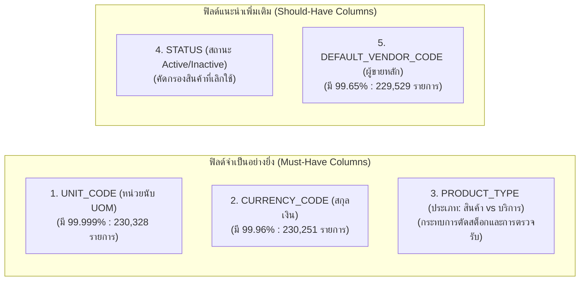
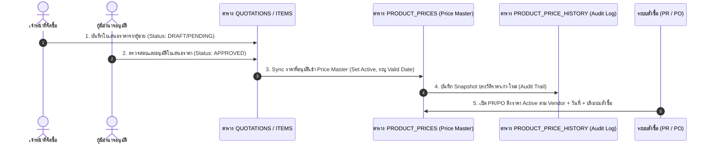
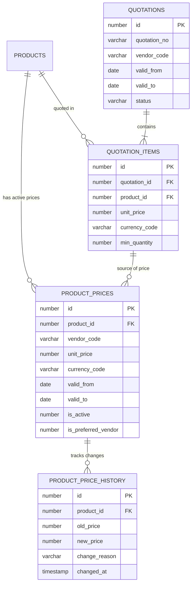
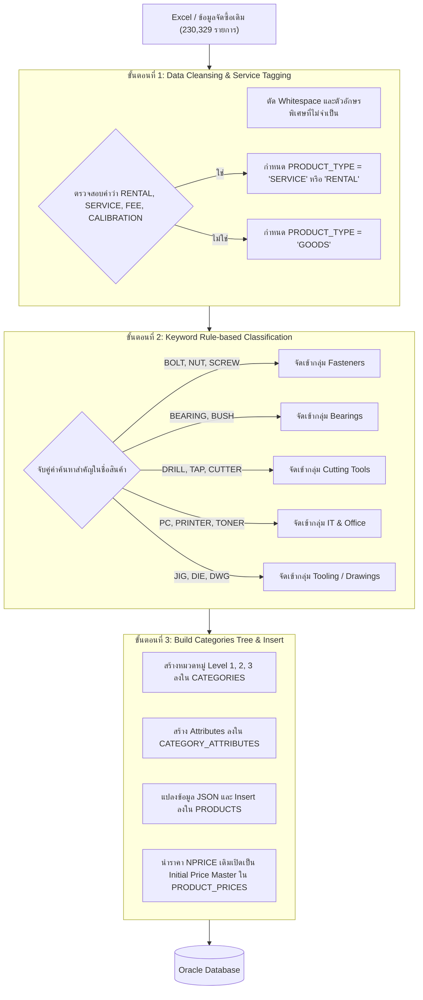

# รายงานการวิเคราะห์และจัดโครงสร้างหมวดหมู่สินค้าใหม่ (Product Categorization & Taxonomy Redesign)

> **แหล่งข้อมูลต้นทาง:** `procurement_products.xlsx` (จำนวน 230,329 รายการ)  
> **โครงสร้างฐานข้อมูลเป้าหมาย:** `Products.SQL` (Oracle Database)  
> **ปรับปรุงล่าสุด:** พฤศจิกายน 2026 (รวมโครงสร้าง Core Columns และระบบ Quotation-Controlled Pricing)

---

## สารบัญ
1. [บทสรุปผู้บริหาร (Executive Summary)](#1-บทสรุปผู้บริหาร-executive-summary)
2. [ผลการวิเคราะห์โครงสร้างข้อมูลเดิม (Legacy System Analysis)](#2-ผลการวิเคราะห์โครงสร้างข้อมูลเดิม-legacy-system-analysis)
3. [รายงานการวิเคราะห์เจาะลึกทั้ง 23 หมวดหมู่งบประมาณเดิม](#3-รายงานการวิเคราะห์เจาะลึกทั้ง-23-หมวดหมู่งบประมาณเดิม)
4. [ปัญหาสำคัญเชิงโครงสร้างและตัวอย่างสินค้าจริงที่ปะปน](#4-ปัญหาสำคัญเชิงโครงสร้างและตัวอย่างสินค้าจริงที่ปะปน)
5. [การออกแบบโครงสร้างหมวดหมู่ใหม่ตาม Products.SQL](#5-การออกแบบโครงสร้างหมวดหมู่ใหม่ตาม-productssql)
6. [การปรับปรุงฟิลด์พื้นฐานของสินค้า (Core Columns vs Dynamic Attributes)](#6-การปรับปรุงฟิลด์พื้นฐานของสินค้า-core-columns-vs-dynamic-attributes)
7. [สถาปัตยกรรมระบบราคา: Price Master + History ควบคุมด้วย Quotation](#7-สถาปัตยกรรมระบบราคา-price-master--history-ควบคุมด้วย-quotation)
8. [ข้อกำหนด Dynamic Attributes (CATEGORY_ATTRIBUTES)](#8-ข้อกำหนด-dynamic-attributes-category_attributes)
9. [การ Mapping ข้อมูลสินค้าและการจัดเก็บ EXTRA_ATTRIBUTES (JSON)](#9-การ-mapping-ข้อมูลสินค้าและการจัดเก็บ-extra_attributes-json)
10. [สรุปโครงสร้าง Database DDL ฉบับสมบูรณ์ (Complete SQL Schema)](#10-สรุปโครงสร้าง-database-ddl-ฉบับสมบูรณ์-complete-sql-schema)
11. [แนวทางการดำเนินงานแปลงข้อมูล (ETL & Migration Pipeline)](#11-แนวทางการดำเนินงานแปลงข้อมูล-etl--migration-pipeline)

---

## 1. บทสรุปผู้บริหาร (Executive Summary)

จากการตรวจสอบไฟล์ **`procurement_products.xlsx`** ซึ่งบันทึกข้อมูลสินค้าจากระบบจัดซื้อเดิมจำนวน **230,329 รายการ** พบว่าระบบเดิมจัดหมวดหมู่ตาม **"ประเภทงบประมาณ / รหัสบัญชี (Budget / Accounting Expense Type)"** ส่งผลให้เกิดปัญหาเชิงโครงสร้างอย่างรุนแรง:

1. **การปะปนของประเภทสินค้าในทุกหมวดหมู่ (Cross-Category Fragmentation):** ผู้ขอซื้อ (Requester) เลือกหมวดตามงบประมาณที่ตนได้รับอนุมัติ ทำให้สินค้าชนิดเดียวกัน (เช่น น็อต, สกรู, ตลับลูกปืน, คอมพิวเตอร์, ดอกสว่าน) กระจายตัวอยู่ใน 5–10 หมวดหมู่ที่แตกต่างกัน
2. **การปะปนกันระหว่างสินค้าจริง (Goods) กับงานบริการ/สัญญาเช่า (Services & Rentals):** มีรายการค่าจ้าง ค่าซ่อม ค่าเช่ารถโฟล์คลิฟท์ ค่าบำบัดของเสีย และค่าธรรมเนียมราชการ แฝงตัวอยู่ในตารางสินค้าสูงถึงกว่า 25,000+ รายการ
3. **การยกระดับตาราง `PRODUCTS` ด้วย Core Procurement Columns:** ดึงข้อมูลที่จำเป็นและใช้ร่วมกันทุกสินค้าออกมาเป็นคอลัมน์จริง ได้แก่ `UNIT_CODE` (หน่วยนับ 99.999%), `CURRENCY_CODE` (สกุลเงิน 99.96%), `PRODUCT_TYPE` (แยก Goods/Service/Rental), `STATUS` (สถานะการใช้งาน) และ `DEFAULT_VENDOR_CODE` (ผู้ขายหลัก 99.65%)
4. **การแยกการจัดการราคาออกจากสินค้า (Quotation-Controlled Pricing Architecture):** ปลดล็อคข้อจำกัดของการ Hardcode ราคาในตารางสินค้า โดยแยกเป็น **Price Master (`PRODUCT_PRICES`)** และ **Price History (`PRODUCT_PRICE_HISTORY`)** ที่ถูกควบคุมด้วย **ใบเสนอราคา (`QUOTATIONS` & `QUOTATION_ITEMS`)** รองรับ Multi-Vendor, Tier/Volume Pricing และการตรวจสอบย้อนหลัง (Audit Trail) 100%

---

## 2. ผลการวิเคราะห์โครงสร้างข้อมูลเดิม (Legacy System Analysis)

Query เดิมที่ถูก Export มายัง Excel:
```sql
SELECT * FROM PPRODUCT a
LEFT JOIN PEXPENSTYPE b ON a.sexptype = b.sexptype
LEFT JOIN PCATTYPE c ON a.scattype = c.scattype
LEFT JOIN pcatalog d ON a.SCATID = d.scatid
```

### สถิติตัวเลขในระบบเดิม:
* **จำนวนสินค้าทั้งหมด:** 230,329 รายการ
* **ระดับ 1 (Expense Type / `PEXPENSTYPE`):** 23 หมวดหลัก
* **ระดับ 2 (Category Type / `PCATTYPE`):** 511 หมวดย่อย
* **ระดับ 3 (Catalog / `pcatalog`):** 4,291 กลุ่มสินค้าย่อย

---

## 3. รายงานการวิเคราะห์เจาะลึกทั้ง 23 หมวดหมู่งบประมาณเดิม

จากการสแกนและประมวลผลข้อความชื่อสินค้า (`SEPRODNAME` และ `STPRODNAME`) ทั้ง 230,329 รายการ สรุปการกระจายตัวของประเภทสินค้าจริงในแต่ละหมวดหมู่เดิมได้ดังนี้:

| รหัส | ชื่อหมวดเดิม (Expense Type) | จำนวนสินค้า (SKU) | สัดส่วน | กลุ่มประเภทสินค้าจริงที่ตรวจพบมากที่สุด | ตัวอย่างสินค้าจริงที่ถูกบันทึกไว้ในหมวดนี้ |
| :---: | :--- | :---: | :---: | :--- | :--- |
| **56** | Factory Maintenance | 75,867 | 32.9% | อิเล็กทรอนิกส์/เซ็นเซอร์ (14.8%), สลักเกลียว (10.2%), ตลับลูกปืน (8.1%), นิวเมติกส์ (7.9%), บริการซ่อม (4.3%) | `HOSE CLAMP # 000`, `BEARING 6205`, `OMRON SENSOR`, `LUBRICANT SPRAY "LUKO"` |
| **10** | Annual Investment | 75,858 | 32.9% | แม่พิมพ์/Jig (12.4%), เครื่องมือตัด (9.3%), สลักเกลียว (7.0%), ไฟฟ้า (6.8%), บริการ/ค่าธรรมเนียม (5.3%), IT (1.4%) | `HP BRIO PC PIII 866MHZ 15" MONITOR`, `STEP DRILL SC-GDR`, `PALET (WOOD) 1200X2200` |
| **20** | Operating Expense | 38,776 | 16.8% | **บริการ/ค่าจ้างกำจัดของเสีย (18.6%)**, แม่พิมพ์/Jig (17.6%), ไฟฟ้า (5.5%), สลักเกลียว (4.0%), เครื่องมือตัด (4.0%) | `WASTE WATER SLUDGE TRANSFER CHARGE`, `CALIBRATION FEE`, `INSPECTION SERVICE TRANSFORMER` |
| **30** | Product Development | 6,629 | 2.9% | อิเล็กทรอนิกส์ (10.1%), สลักเกลียว (8.1%), โซ่/เพลาส่งกำลัง (5.8%), แม่พิมพ์ (4.8%), อุปกรณ์เซฟตี้ | `STEP CHAIN 6 UNITS (L-SIDE)`, `HANDRAIL PIPING TYPE A`, `GOV.SHOE (YA119D038-01)` |
| **70** | G/P Expense | 5,648 | 2.5% | อุปกรณ์เซฟตี้/PPE (10.2%), ค่าบริการ/ค่าวีซ่า (5.8%), เฟอร์นิเจอร์ (3.7%), เครื่องเขียน (2.3%) | `SAFETY SHOES MODEL KSSKWS800`, `ANNIVERSARY DECORATION LIGHT`, `MULTIPLE VISA FEE` |
| **40** | Special Project | 5,482 | 2.4% | Jig & Fixture (25.3%), สลักเกลียว (8.7%), เครื่องมือช่าง (7.4%), ไฟฟ้า (5.2%), เพลาส่งกำลัง (4.6%) | `HAND CRIMPING TOOL (1276654-1)`, `MACHINE SHAFT 60X1800`, `CLAMPING JIG DWG.YA160B652` |
| **51** | Expendable Tools | 4,037 | 1.8% | เครื่องมือตัดแต่ง (53.9%), สลักเกลียว/ข้อต่อลม (6.8%), เครื่องเขียน (2.8%), แม่พิมพ์ (2.2%) | `HOLDER MTJNR 2525M 16M1 (SANDVIK)`, `SPRING AIR HOSE TPS 803+COUPLER (CHIYODA)` |
| **90** | Purchasing Expense | 3,968 | 1.7% | ชิ้นส่วนสั่งทำตาม Drawing, คอนเนคเตอร์ (8.9%), สกรู/น็อต (8.5%), ตลับลูกปืน (3.1%) | `CONNECTOR DWG.NO.X39DM-135`, `JOB ORDER PART` |
| **B0** | Mfg self-improvement | 3,291 | 1.4% | อุปกรณ์ Kaizen, ล้อยูรีเทน, สลิงยกของ, โซ่ส่งกำลัง, ท่อลม, วาล์วนิวเมติกส์ | `URETANE WHEEL 6 INCH`, `WIRE ROPE SLING WITH CROSBY HOOK 1.5T`, `MASTER VALVE PT 1/4"` |
| **55** | Computer Accessories | 3,094 | 1.3% | อุปกรณ์ไอที (27.9%), อุปกรณ์จ่ายไฟ/สายไฟ (15.3%), **บริการซ่อมจอ/คอมพิวเตอร์ (10.3%)** | `POWER SUPPLY 350 W ATX FOR PC`, `SERVICE CHARGE FOR MONITOR 17 INCH REPARATION` |
| **52** | Expendable Parts | 2,734 | 1.2% | อะไหล่สิ้นเปลือง, เครื่องเขียน (8.1%), เซฟตี้ (7.9%), ทินเนอร์/เคมีภัณฑ์ (5.4%), ตะกั่วบัดกรี | `F0113-THINNER`, `SOLDER WIRE SPARKLE RMA22 SN60 1.6MM`, `SUPER LAMP 220V 60W` |
| **60** | Packing | 1,667 | 0.7% | กล่อง/พาเลท (28.4%), สลักเกลียว (4.3%), สติกเกอร์มอเตอร์, ค่าจ้างแรงงานแพ็ค | `BOLT M10X1.50X120 PK096`, `SUB MAT. STICKER DWG ST001`, `OPERATOR PACKING` |
| **54** | Stationery | 1,560 | 0.7% | เครื่องเขียน (18.6%), **ตะไบช่าง (7.2%)**, ตลับหมึกเลเซอร์ (Toner 3.5%), ปากกาเน้นข้อความ | `SPARE FILE FOR FILE NO.771 (ตะไบช่าง)`, `TONER CARTRIDGE 92274 A`, `FLUORESCENT PEN` |
| **50** | Factory Consumption | 502 | 0.2% | **สัญญาเช่ารถโฟล์คลิฟท์ (68.1%)**, แบตเตอรี่, ถังแก๊ส LPG 15 กก., ค่ารื้อถอนแร็ค | `RENTAL CONTRACT FOR FORKLIFT MITSUBISHI 2.5 TONS`, `LPG 15 KG. FOR FORKLIFT` |
| **80** | Marketing Expense | 326 | 0.1% | แฟ้มเอกสาร (7.7%), โต๊ะทำงาน (7.1%), โต๊ะคอมพิวเตอร์ (4.0%), สิ่งพิมพ์ | `COMPUTER TABLE MODEL: TEN-7070`, `FLAT DESK`, `FILE COVER A4 350 G` |
| **57** | Furniture E/P | 308 | 0.1% | เก้าอี้/โต๊ะทำงาน (51.6%), โต๊ะคอมพิวเตอร์ (1.9%), ตู้เก็บเอกสารการ์ด | `CH-405 STOOL CHAIR SWIVEL AND HEIGHT ADJUSTABLE`, `COMPUTER TABLE REF.DWG` |
| **53** | Furniture E/P & Mfg (ยกเลิก) | 226 | 0.1% | เก้าอี้ทำงาน, โต๊ะคอมพิวเตอร์, ค่าซ่อมเก้าอี้ | `STOOL CHAIR MODEL:CH-405`, `COMPUTER TABLE TEN-7070`, `REPAIR ARMCHAIR` |
| **58** | Furniture Mfg | 132 | 0.1% | เก้าอี้ทำงาน (51.5%), โต๊ะคอมพิวเตอร์ (3.8%), กล่องพลาสติก | `CH-405 STOOL CHAIR`, `COMPUTER TABLE MODEL-DH-20LL`, `PLASTIC BOX CODE # 033` |
| **85** | Furniture Q/A | 95 | 0.04% | โต๊ะทำงานอเนกประสงค์ (62.1%), ตู้เก็บรองเท้าเซฟตี้ | `VERSATILE TABLE TG-80120`, `SHOE CABINET SCH840N` |
| **75** | Furniture DED | 60 | 0.03% | เก้าอี้พนักงานสำนักงาน | `CHAIR MODEL PP-63 ขาเหล็ก สีเทาปุย (USE FOR STAFF)` |
| **A0** | Financial Expense | 44 | 0.02% | ค่าบำรุงรักษาระบบโปรแกรมเงินเดือน, ฟอร์มสลิปเงินเดือนต่อเนื่อง, ที่เจาะกระดาษ | `ANNUAL MAINTENANCE - PAYROLL SYSTEM`, `BILLING SLIP FORM (1 BOX=2,000 SHEETS)` |
| **D0** | Furniture R&D | 22 | 0.01% | เสากั้นทางเดินพร้อมโซ่ | `TRUSCO CHAIN STAND T-CSY` |
| **F0** | EP Special Budget | 3 | 0.001% | ค่าบริการศึกษาเทคโนโลยีประหยัดพลังงาน (Service 100%) | `TECHNICIAN SERVICE ENERGY - SAVING TECHNOLOGY STUDY` |

---

## 4. ปัญหาสำคัญเชิงโครงสร้างและตัวอย่างสินค้าจริงที่ปะปน

### ปัญหาที่ 1: สินค้าชนิดเดียวกันกระจายตัวข้ามหมวดหมู่ (Cross-Category Fragmentation)

1. **สลักเกลียวและน็อต (BOLT, NUT, SCREW, WASHER) — รวมกว่า 16,000+ รายการ**
   * หมวด 56 (Factory Maintenance): **7,761 รายการ**
   * หมวด 10 (Annual Investment): **5,343 รายการ**
   * หมวด 20 (Operating Expense): **1,562 รายการ**
   * หมวด 30, 40, 51, 60, 90, B0: **อีกกว่า 1,500+ รายการ**
   * *ผลกระทบ:* ฝ่ายจัดซื้อไม่สามารถสรุปยอดรวม (Consolidate Volume) เพื่อต่อรองราคาส่วนลดกับผู้ผลิตสลักเกลียวได้

2. **ตลับลูกปืน (BEARING, BUSHING) — รวมกว่า 10,000+ รายการ**
   * หมวด 56 (Maintenance): **6,108 รายการ**
   * หมวด 10 (Investment): **2,617 รายการ**
   * หมวด 20 (Operating Exp): **1,021 รายการ**
   * หมวด 30, 40, 90: **อีกกว่า 700+ รายการ**

3. **เครื่องมือตัดและช่างกล (CUTTING TOOLS: DRILL, ENDMILL, TAP, CUTTER) — รวมกว่า 11,000+ รายการ**
   * อยู่ในหมวด 10 (งบลงทุน): **7,068 รายการ** *(มากกว่าหมวดเครื่องมือโดยตรง)*
   * อยู่ในหมวด 51 (Expendable Tools ซึ่งเป็นหมวดเฉพาะ): เพียง **2,175 รายการ**
   * อยู่ในหมวด 20, 40, 54: **อีกกว่า 2,000+ รายการ**

4. **การแตกหมวดหมู่ตามหน่วยงานโดยไม่จำเป็น (Organizational Silos)**
   * สินค้าหมวด **Furniture (โต๊ะ/เก้าอี้)** ถูกแยกออกเป็น 6 หมวดตามแผนก: `57 (E/P)`, `58 (Mfg)`, `75 (DED)`, `85 (QA)`, `D0 (R&D)`, `53 (เก่า)` ทั้งที่สินค้าแทบจะเป็นรหัสและรุ่นเดียวกัน เช่น `STOOL CHAIR CH-405`

---

### ปัญหาที่ 2: งานบริการ สัญญาเช่า และค่าธรรมเนียม ปะปนกับสินค้า (Goods vs Services)

ระบบเดิมนำรายการที่ไม่ใช่สินค้าทางกายภาพ (Non-physical goods) มารวมอยู่ในรหัสสินค้า:
* **หมวด 50 (Factory Consumption):** มีสินค้าจริงเพียง 30% อีก **68.1% เป็นสัญญาเช่ารถโฟล์คลิฟท์** เช่น `RENTAL CONTRACT FOR FORKLIFT R.6 MITSUBISHI 2.5 TONS`
* **หมวด 20 (Operating Expense):** มีรายการ **บริการและค่าธรรมเนียมถึง 18.6% (7,199 รายการ)** เช่น ค่าบำบัดน้ำเสีย, ค่าสอบเทียบ (Calibration Fee), ค่าตรวจเช็คหม้อแปลงประจำปี, ค่าทางด่วน
* **หมวด 70, A0, F0:** ค่าธรรมเนียมวีซ่า, ค่าบำรุงรักษาระบบซอฟต์แวร์ (MA), ค่าที่ปรึกษาด้านวิศวกรรม

---

## 5. การออกแบบโครงสร้างหมวดหมู่ใหม่ตาม Products.SQL

ตาราง `CATEGORIES` ใช้รูปแบบ **Adjacency List (Tree Structure ด้วย `PARENT_ID`)** เพื่อรองรับการจัดกลุ่มตามลักษณะทางกายภาพที่แท้จริง (Physical Material & Service Taxonomy):

```mermaid
graph TD
    Root["CATEGORIES (Root Level)"]

    C1["1. เครื่องมือตัดแต่งและงานช่าง (Cutting Tools & Tooling)"]
    C2["2. ชิ้นส่วนมาตรฐานและยึดติด (Fasteners & Hardware)"]
    C3["3. อุปกรณ์ส่งกำลังและลูกปืน (Bearings & Transmission)"]
    C4["4. ระบบลมและไฮดรอลิกส์ (Pneumatics & Hydraulics)"]
    C5["5. ระบบไฟฟ้า อิเล็กทรอนิกส์ และเซ็นเซอร์ (Electrical & Automation)"]
    C6["6. เคมีภัณฑ์ น้ำมันหล่อลื่น และสี (Chemicals & Lubricants)"]
    C7["7. อุปกรณ์คอมพิวเตอร์และสำนักงาน (IT, Office & Furniture)"]
    C8["8. อุปกรณ์ความปลอดภัยและสิ่งแวดล้อม (Safety & PPE)"]
    C9["9. วัสดุบรรจุภัณฑ์ (Packaging Materials)"]
    C10["10. แม่พิมพ์ จิ๊ก และชิ้นส่วนเฉพาะเครื่องจักร (Molds, Dies, Jigs & Parts)"]
    C11["11. งานบริการ สัญญาเช่า และค่าธรรมเนียม (Services, Rentals & Fees)"]

    Root --> C1
    Root --> C2
    Root --> C3
    Root --> C4
    Root --> C5
    Root --> C6
    Root --> C7
    Root --> C8
    Root --> C9
    Root --> C10
    Root --> C11

    C1 --> C1_1["1.1 Drills (ดอกสว่าน)"]
    C1 --> C1_2["1.2 Endmills (ดอกเอ็นมิล)"]
    C1 --> C1_3["1.3 Taps & Dies (ดอกต๊าป)"]
    C1 --> C1_4["1.4 Inserts & Holders (เม็ดมีด/ด้ามมีด)"]

    C2 --> C2_1["2.1 Hex Bolts (สลักเกลียวหกเหลี่ยม)"]
    C2 --> C2_2["2.2 Socket Cap Screws (สกรูหัวจมหกเหลี่ยม)"]
    C2 --> C2_3["2.3 Nuts & Washers (หัวน็อตและแหวน)"]

    C11 --> C11_1["11.1 Equipment Rental (สัญญาเช่าเครื่องจักร/โฟล์คลิฟท์)"]
    C11 --> C11_2["11.2 Calibration & Testing (ค่าสอบเทียบและทดสอบ)"]
    C11 --> C11_3["11.3 Waste Management & Disposal (ค่าบำบัดของเสีย)"]
```



---

## 6. การปรับปรุงฟิลด์พื้นฐานของสินค้า (Core Columns vs Dynamic Attributes)

จากการตรวจสอบสถิติข้อมูลจริง 230,329 รายการ มีอย่างน้อย **5 ฟิลด์หลักที่จำเป็นต้องใช้ซ้ำๆ ในทุกสินค้า** ซึ่งไม่ควรซ่อนอยู่ใน JSON `EXTRA_ATTRIBUTES` แต่ควรดึงออกมาเป็น First-Class Columns ในตาราง `PRODUCTS`:



### รายละเอียดและเหตุผลทางธุรกิจ:
1. **`UNIT_CODE` (UOM - หน่วยนับหลัก):** มีข้อมูลถึง 99.999% ในระบบจัดซื้อขาดหน่วยนับไม่ได้ จำเป็นต้องใช้ `SUM` รวมยอด และทำ Foreign Key
2. **`CURRENCY_CODE` (สกุลเงิน):** การเก็บตัวเลขราคาโดยไม่มีสกุลเงินกำกับมีความเสี่ยงสูงมาก (เช่น 1,000 THB vs 1,000 USD vs 1,000 JPY)
3. **`PRODUCT_TYPE` (`GOODS` / `SERVICE` / `RENTAL`):** ใช้แยกรายการสินค้าทางกายภาพ (ตัดสต็อก/ทำ GR) ออกจากงานบริการและสัญญาเช่า (ตรวจรับงานจ้าง/ไม่ตัดสต็อก)
4. **`STATUS` (`ACTIVE` / `INACTIVE` / `DISCONTINUED`):** สำหรับควบคุมไม่ให้เปิด PR/PO สินค้าที่เลิกผลิตแล้ว โดยไม่ต้องลบข้อมูลประวัติทิ้ง
5. **`DEFAULT_VENDOR_CODE` (ผู้ขายหลัก):** ช่วยให้ฝ่ายจัดซื้อคิวรีสินค้าตามคู่ค้าเพื่อรวมใบสั่งซื้อ (PO Consolidation) ได้ทันที

---

## 7. สถาปัตยกรรมระบบราคา: Price Master + History ควบคุมด้วย Quotation

ในระบบจัดซื้อระดับสากล (Enterprise Procurement) **สินค้า 1 รายการสามารถซื้อได้จากหลายผู้ขาย (Multi-Vendor), มีราคาผันผวนตามช่วงเวลา (Validity Dates), เปลี่ยนแปลงตามปริมาณสั่งซื้อ (Tier/Volume Pricing) และต้องมีเอกสารอ้างอิงทางกฎหมาย**

จึงต้องแยกการจัดการราคาออกจากตาราง `PRODUCTS` แล้วนำไปควบคุมด้วย **ใบเสนอราคา (Quotation)** ดังนี้:

### 7.1 ผังการทำงาน (Quotation-Controlled Pricing Flow)



### 7.2 ผังความสัมพันธ์ตารางระบบราคา (ER Diagram)



---

## 8. ข้อกำหนด Dynamic Attributes (CATEGORY_ATTRIBUTES)

เมื่อย้าย Core Procurement Columns ออกมาแล้ว ตาราง `CATEGORY_ATTRIBUTES` จะทำหน้าที่เก็บเฉพาะ **"สเปกเฉพาะทางตามประเภทสินค้า (Technical Specs)"** เท่านั้น:

| กลุ่มหมวดหมู่ (Category Group) | Attribute Name | Data Type | Option Source | Fixed Options / คำอธิบาย |
| :--- | :--- | :---: | :---: | :--- |
| **Fasteners & Hardware** | `thread_size` | `text` | `none` | เช่น M3, M4, M5, M6, M8, M10, 5/16" |
| | `pitch` | `number` | `none` | ระยะพิทช์เกลียว เช่น 1.0, 1.25, 1.5 |
| | `length` | `number` | `none` | ความยาว (มม.) |
| | `material_grade` | `option` | `fixed` | `["SUS304", "SUS316", "Steel 8.8", "Steel 10.9", "Brass"]` |
| **Bearings & Transmission** | `bearing_number` | `text` | `none` | เบอร์ตลับลูกปืน เช่น 6205, 6303ZZ, 608 |
| | `inner_diameter` | `number` | `none` | ขนาดรูใน (มม.) |
| | `outer_diameter` | `number` | `none` | ขนาดขอบนอก (มม.) |
| **Cutting Tools** | `tool_type` | `option` | `fixed` | `["Drill", "Endmill", "Tap", "Insert", "Reamer", "Cutter"]` |
| | `shank_dia` | `number` | `none` | ขนาดก้านจับ (มม.) |
| | `coating` | `text` | `none` | สารเคลือบผิว เช่น TiN, TiAlN, DLC |
| **Machining & Mold Parts** | `drawing_no` | `text` | `none` | เลขที่แบบแปลนวิศวกรรม |
| | `model` | `text` | `none` | รุ่นเครื่องจักรที่รองรับ |
| **Electrical & Electronics** | `voltage` | `text` | `none` | แรงดันไฟฟ้า เช่น 24VDC, 220VAC, 380VAC |
| | `current_rating` | `text` | `none` | พิกัดกระแส เช่น 10A, 100A |
| **IT & Office Equipment** | `device_type` | `option` | `fixed` | `["Desktop PC", "Laptop", "Monitor", "Printer", "UPS", "Server"]` |
| | `specs_summary` | `text` | `none` | สเปกหลัก (CPU / RAM / Storage) |
| **Chemicals & Lubricants** | `hazard_status` | `option` | `fixed` | `["Non-Hazardous", "Hazardous"]` |
| | `hazard_no` | `text` | `none` | รหัสวัตถุอันตราย / UN Number / CAS No. |
| **Services & Rentals** | `service_period` | `text` | `none` | ระยะเวลาสัญญา เช่น รายเดือน, รายปี, รายครั้ง |

---

## 9. การ Mapping ข้อมูลสินค้าและการจัดเก็บ EXTRA_ATTRIBUTES (JSON)

### 9.1 ตัวอย่าง JSON ในคอลัมน์ `EXTRA_ATTRIBUTES`

#### ตัวอย่างที่ 1: สลักเกลียว (Bolt)
```json
{
  "thread_size": "M10",
  "pitch": 1.5,
  "length": 120,
  "material_grade": "Steel 8.8",
  "legacy_tracking": {
    "expense_type": "56",
    "expense_desc": "Factory Maintenance",
    "category_type": "561",
    "catalog_id": "56101",
    "account_code": "56101"
  }
}
```

#### ตัวอย่างที่ 2: เครื่องคอมพิวเตอร์ (เดิมอยู่ในงบลงทุน 10)
```json
{
  "device_type": "Desktop PC",
  "brand": "HP",
  "model": "BRIO",
  "specs": {
    "cpu": "Pentium III 866 MHz",
    "ram": "128 MB SDRAM",
    "hdd": "20 GB",
    "monitor": "15 inch"
  },
  "legacy_tracking": {
    "expense_type": "10",
    "expense_desc": "Annual Investment (Budget Requisition)",
    "catalog_id": "151I01"
  }
}
```

#### ตัวอย่างที่ 3: สัญญาเช่ารถโฟล์คลิฟท์ (เดิมอยู่ในหมวด 50)
```json
{
  "service_type": "Forklift Rental",
  "equipment_details": {
    "brand": "MITSUBISHI",
    "capacity": "2.5 Tons",
    "model": "FG20T",
    "serial_no": "F17D-00587"
  },
  "legacy_tracking": {
    "expense_type": "50",
    "expense_desc": "Factory Consumption",
    "catalog_id": "50101"
  }
}
```

---

## 10. สรุปโครงสร้าง Database DDL ฉบับสมบูรณ์ (Complete SQL Schema)

ชุดคำสั่ง DDL ภาษา SQL สำหรับสร้างระบบทั้งหมดบน **Oracle Database**:

```sql
-- ============================================================================
-- 1. ตาราง CATEGORIES (โครงสร้างหมวดหมู่สินค้าแบบ Tree)
-- ============================================================================
CREATE TABLE CATEGORIES (
    ID NUMBER GENERATED BY DEFAULT AS IDENTITY PRIMARY KEY,
    NAME VARCHAR2(255) NOT NULL,
    PARENT_ID NUMBER,
    CONSTRAINT FK_CATEGORIES_PARENT
        FOREIGN KEY (PARENT_ID) REFERENCES CATEGORIES(ID) ON DELETE CASCADE
);
CREATE INDEX IDX_CATEGORIES_PARENT ON CATEGORIES(PARENT_ID);


-- ============================================================================
-- 2. ตาราง CATEGORY_ATTRIBUTES (Dynamic Attributes Registry)
-- ============================================================================
CREATE TABLE CATEGORY_ATTRIBUTES (
    ID NUMBER GENERATED BY DEFAULT AS IDENTITY PRIMARY KEY,
    CATEGORY_ID NUMBER NOT NULL,
    NAME VARCHAR2(100) NOT NULL,
    DATA_TYPE VARCHAR2(20) DEFAULT 'text' NOT NULL,
    IS_REQUIRED NUMBER(1) DEFAULT 0 NOT NULL,
    OPTION_SOURCE VARCHAR2(20) DEFAULT 'none' NOT NULL,
    FIXED_OPTIONS CLOB,
    FUNCTION_NAME VARCHAR2(100),

    CONSTRAINT FK_CAT_ATTR_CATEGORY
        FOREIGN KEY (CATEGORY_ID) REFERENCES CATEGORIES(ID) ON DELETE CASCADE,
    CONSTRAINT UK_CAT_ATTR_NAME UNIQUE (CATEGORY_ID, NAME),
    CONSTRAINT CHK_CAT_ATTR_DATA_TYPE CHECK (DATA_TYPE IN ('text', 'number', 'option')),
    CONSTRAINT CHK_CAT_ATTR_IS_REQ CHECK (IS_REQUIRED IN (0, 1)),
    CONSTRAINT CHK_CAT_ATTR_OPT_SRC CHECK (OPTION_SOURCE IN ('none', 'fixed', 'function')),
    CONSTRAINT CHK_FIXED_OPTIONS_JSON CHECK (FIXED_OPTIONS IS NULL OR FIXED_OPTIONS IS JSON)
);
CREATE INDEX IDX_CAT_ATTR_CATEGORY ON CATEGORY_ATTRIBUTES(CATEGORY_ID);


-- ============================================================================
-- 3. ตาราง PRODUCTS (ข้อมูลสินค้าหลัก + Core Procurement Columns)
-- ============================================================================
CREATE TABLE PRODUCTS (
    ID NUMBER GENERATED BY DEFAULT AS IDENTITY PRIMARY KEY,
    SKU VARCHAR2(100) NOT NULL,
    NAME VARCHAR2(255) NOT NULL,
    DESCRIPTION CLOB,
    
    -- Core Procurement Columns
    UNIT_CODE VARCHAR2(20) DEFAULT 'Pce' NOT NULL,       -- หน่วยนับหลัก (UOM)
    PRODUCT_TYPE VARCHAR2(20) DEFAULT 'GOODS' NOT NULL,  -- GOODS, SERVICE, RENTAL
    STATUS VARCHAR2(20) DEFAULT 'ACTIVE' NOT NULL,       -- ACTIVE, INACTIVE, DISCONTINUED
    CATEGORY_ID NUMBER,
    DEFAULT_VENDOR_CODE VARCHAR2(50),                    -- รหัสผู้จำหน่ายหลัก
    
    -- สรุปประวัติราคาล่าสุด (Optional Cache)
    LAST_PURCHASE_PRICE NUMBER(14, 4) DEFAULT 0,
    LAST_PURCHASE_CURRENCY VARCHAR2(10) DEFAULT 'Bt.',
    LAST_PURCHASE_DATE DATE,
    
    -- Dynamic Extra Attributes
    EXTRA_ATTRIBUTES CLOB DEFAULT '{}',
    
    -- Audit Timestamps
    CREATED_AT TIMESTAMP DEFAULT CURRENT_TIMESTAMP NOT NULL,
    UPDATED_AT TIMESTAMP DEFAULT CURRENT_TIMESTAMP NOT NULL,
    DELETED_AT TIMESTAMP,

    CONSTRAINT UK_PRODUCTS_SKU UNIQUE (SKU),
    CONSTRAINT FK_PRODUCTS_CATEGORY
        FOREIGN KEY (CATEGORY_ID) REFERENCES CATEGORIES(ID) ON DELETE SET NULL,
    CONSTRAINT CHK_PRODUCTS_TYPE CHECK (PRODUCT_TYPE IN ('GOODS', 'SERVICE', 'RENTAL')),
    CONSTRAINT CHK_PRODUCTS_STATUS CHECK (STATUS IN ('ACTIVE', 'INACTIVE', 'DISCONTINUED')),
    CONSTRAINT CHK_EXTRA_ATTRS_JSON CHECK (EXTRA_ATTRIBUTES IS NULL OR EXTRA_ATTRIBUTES IS JSON)
);
CREATE INDEX IDX_PRODUCTS_CATEGORY ON PRODUCTS(CATEGORY_ID);
CREATE INDEX IDX_PRODUCTS_TYPE ON PRODUCTS(PRODUCT_TYPE);
CREATE INDEX IDX_PRODUCTS_STATUS ON PRODUCTS(STATUS);
CREATE INDEX IDX_PRODUCTS_VENDOR ON PRODUCTS(DEFAULT_VENDOR_CODE);
CREATE INDEX IDX_PRODUCTS_DELETED_AT ON PRODUCTS(DELETED_AT);


-- ============================================================================
-- 4. ตาราง QUOTATIONS (ใบเสนอราคาจากผู้ขาย - Header)
-- ============================================================================
CREATE TABLE QUOTATIONS (
    ID NUMBER GENERATED BY DEFAULT AS IDENTITY PRIMARY KEY,
    QUOTATION_NO VARCHAR2(100) NOT NULL,          -- เลขที่ใบเสนอราคา
    VENDOR_CODE VARCHAR2(50) NOT NULL,             -- รหัสคู่ค้า/ผู้ขาย
    VENDOR_NAME VARCHAR2(255),                     -- ชื่อคู่ค้า
    QUOTATION_DATE DATE NOT NULL,                  -- วันที่เสนอราคา
    VALID_FROM DATE NOT NULL,                      -- วันที่เริ่มมีผลคุ้มครองราคา
    VALID_TO DATE NOT NULL,                        -- วันที่สิ้นสุดความคุ้มครองราคา
    STATUS VARCHAR2(20) DEFAULT 'DRAFT' NOT NULL,  -- DRAFT, PENDING, APPROVED, REJECTED, EXPIRED
    APPROVED_BY VARCHAR2(100),                     -- ผู้อนุมัติราคา
    APPROVED_AT TIMESTAMP,                         -- วันเวลาที่อนุมัติ
    DOCUMENT_URL VARCHAR2(500),                    -- ลิงก์ไฟล์แนบเอกสาร (PDF)
    REMARKS CLOB,
    CREATED_AT TIMESTAMP DEFAULT CURRENT_TIMESTAMP NOT NULL,
    
    CONSTRAINT UK_QUOTATION_NO_VENDOR UNIQUE (QUOTATION_NO, VENDOR_CODE),
    CONSTRAINT CHK_QUOTATION_STATUS CHECK (STATUS IN ('DRAFT', 'PENDING', 'APPROVED', 'REJECTED', 'EXPIRED'))
);
CREATE INDEX IDX_QUOTATIONS_VENDOR ON QUOTATIONS(VENDOR_CODE);
CREATE INDEX IDX_QUOTATIONS_STATUS ON QUOTATIONS(STATUS);


-- ============================================================================
-- 5. ตาราง QUOTATION_ITEMS (รายการสินค้าในใบเสนอราคา - Detail)
-- ============================================================================
CREATE TABLE QUOTATION_ITEMS (
    ID NUMBER GENERATED BY DEFAULT AS IDENTITY PRIMARY KEY,
    QUOTATION_ID NUMBER NOT NULL,
    PRODUCT_ID NUMBER NOT NULL,
    UNIT_CODE VARCHAR2(20) NOT NULL,
    UNIT_PRICE NUMBER(14, 4) NOT NULL,             -- ราคาต่อหน่วย (ทศนิยม 4 ตำแหน่ง)
    CURRENCY_CODE VARCHAR2(10) DEFAULT 'Bt.' NOT NULL,
    MIN_QUANTITY NUMBER(12, 2) DEFAULT 1 NOT NULL, -- ปริมาณสั่งซื้อขั้นต่ำ / Tier
    LEAD_TIME_DAYS NUMBER(5) DEFAULT 0,            -- ระยะเวลาส่งมอบ (วัน)
    REMARKS VARCHAR2(255),

    CONSTRAINT FK_QT_ITEMS_QUOTATION 
        FOREIGN KEY (QUOTATION_ID) REFERENCES QUOTATIONS(ID) ON DELETE CASCADE,
    CONSTRAINT FK_QT_ITEMS_PRODUCT 
        FOREIGN KEY (PRODUCT_ID) REFERENCES PRODUCTS(ID) ON DELETE CASCADE
);
CREATE INDEX IDX_QT_ITEMS_PROD ON QUOTATION_ITEMS(PRODUCT_ID);
CREATE INDEX IDX_QT_ITEMS_QT ON QUOTATION_ITEMS(QUOTATION_ID);


-- ============================================================================
-- 6. ตาราง PRODUCT_PRICES (Price Master / Purchasing Info Record)
-- ============================================================================
CREATE TABLE PRODUCT_PRICES (
    ID NUMBER GENERATED BY DEFAULT AS IDENTITY PRIMARY KEY,
    PRODUCT_ID NUMBER NOT NULL,
    VENDOR_CODE VARCHAR2(50) NOT NULL,
    QUOTATION_ITEM_ID NUMBER,                      -- ผูกกับ Item ในใบเสนอราคาที่ใช้อ้างอิง
    UNIT_CODE VARCHAR2(20) NOT NULL,
    UNIT_PRICE NUMBER(14, 4) NOT NULL,
    CURRENCY_CODE VARCHAR2(10) DEFAULT 'Bt.' NOT NULL,
    MIN_QUANTITY NUMBER(12, 2) DEFAULT 1 NOT NULL, -- สั่งซื้อขั้นต่ำ หรือ Tier
    VALID_FROM DATE NOT NULL,
    VALID_TO DATE NOT NULL,
    IS_ACTIVE NUMBER(1) DEFAULT 1 NOT NULL,        -- 1 = ใช้งานได้, 0 = หมดอายุ/ยกเลิก
    IS_PREFERRED_VENDOR NUMBER(1) DEFAULT 0 NOT NULL, -- ผู้ขายหลักของสินค้านี้หรือไม่
    CREATED_AT TIMESTAMP DEFAULT CURRENT_TIMESTAMP NOT NULL,
    UPDATED_AT TIMESTAMP DEFAULT CURRENT_TIMESTAMP NOT NULL,

    CONSTRAINT FK_PROD_PRICES_PRODUCT 
        FOREIGN KEY (PRODUCT_ID) REFERENCES PRODUCTS(ID) ON DELETE CASCADE,
    CONSTRAINT FK_PROD_PRICES_QT_ITEM 
        FOREIGN KEY (QUOTATION_ITEM_ID) REFERENCES QUOTATION_ITEMS(ID) ON DELETE SET NULL,
    CONSTRAINT CHK_PROD_PRICES_ACTIVE CHECK (IS_ACTIVE IN (0, 1)),
    CONSTRAINT CHK_PROD_PRICES_PREF CHECK (IS_PREFERRED_VENDOR IN (0, 1))
);
CREATE INDEX IDX_PROD_PRICES_LOOKUP ON PRODUCT_PRICES(PRODUCT_ID, VENDOR_CODE, IS_ACTIVE, VALID_FROM, VALID_TO);


-- ============================================================================
-- 7. ตาราง PRODUCT_PRICE_HISTORY (ประวัติการเปลี่ยนแปลงราคา / Audit Log)
-- ============================================================================
CREATE TABLE PRODUCT_PRICE_HISTORY (
    ID NUMBER GENERATED BY DEFAULT AS IDENTITY PRIMARY KEY,
    PRODUCT_PRICE_ID NUMBER NOT NULL,              -- อ้างอิง Price Master Record
    PRODUCT_ID NUMBER NOT NULL,
    VENDOR_CODE VARCHAR2(50) NOT NULL,
    QUOTATION_ID NUMBER,                           -- ใบเสนอราคาที่ทำให้ราคาเปลี่ยน
    OLD_PRICE NUMBER(14, 4),
    NEW_PRICE NUMBER(14, 4) NOT NULL,
    CURRENCY_CODE VARCHAR2(10) NOT NULL,
    CHANGE_REASON VARCHAR2(255),                   -- สาเหตุการเปลี่ยนราคา
    EFFECTIVE_DATE DATE NOT NULL,
    CHANGED_BY VARCHAR2(100) NOT NULL,             -- ผู้บันทึก/อนุมัติ
    CHANGED_AT TIMESTAMP DEFAULT CURRENT_TIMESTAMP NOT NULL
);
CREATE INDEX IDX_PRICE_HIST_PROD ON PRODUCT_PRICE_HISTORY(PRODUCT_ID, VENDOR_CODE);
```

---

## 11. แนวทางการดำเนินงานแปลงข้อมูล (ETL & Migration Pipeline)



### สรุปผลประโยชน์ที่จะได้รับจากการปรับปรุงโครงสร้างรอบนี้
1. **การรวมอำนาจต่อรองราคา (Procurement Volume Consolidation):** ฝ่ายจัดซื้อสามารถดึงยอดสั่งซื้อรวมของสินค้าประเภทเดียวกันมารวมศูนย์เพื่อขอส่วนลดปริมาณ (Volume Rebate) ได้ทันที
2. **การควบคุมสต็อกที่แม่นยำ (Clean Inventory Management):** แยกรายการสินค้าที่มีสต็อก (`GOODS`) ออกจากงานบริการและสัญญาเช่า (`SERVICE`/`RENTAL`) อย่างสิ้นเชิง หมดปัญหาสต็อกคงค้างผิดปกติ
3. **การควบคุมราคาโปร่งใส ป้องกันทุจริต (Fraud Prevention & Compliance):** เจ้าหน้าที่จัดซื้อไม่สามารถคีย์ราคาตามอำเภอใจได้ เพราะราคาต้องถูกควบคุมด้วยใบเสนอราคา (`QUOTATIONS`) ที่ได้รับอนุมัติในระบบแล้วเท่านั้น
4. **ความถูกต้องทางบัญชีคงเดิม 100% (Zero Business Disruption):** การเก็บรหัส `legacy_tracking` ไว้ใน `EXTRA_ATTRIBUTES` ทำให้ฝ่ายบัญชียังคงสามารถออกรายงานแยกตามงบประมาณ (Budget Cost Center) เดิมได้ทุกประการ
