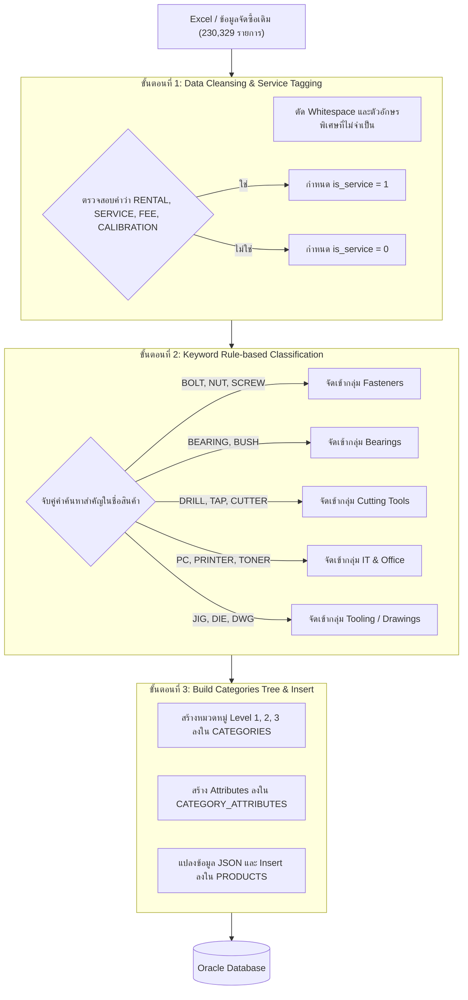

```mermaid
graph TD
    Root["CATEGORIES (Root Level)"]

    C1["1. เครื่องมือตัดแต่งและงานช่าง (Cutting Tools & Tooling)"]
    C2["2. ชิ้นส่วนมาตรฐานและยึดติด (Fasteners & Hardware)"]
    C3["3. อุปกรณ์ส่งกำลังและลูกปืน (Bearings & Transmission)"]
    C4["4. ระบบลมและไฮดรอลิกส์ (Pneumatics & Hydraulics)"]
    C5["5. ระบบไฟฟ้า อิเล็กทรอนิกส์ และเซ็นเซอร์ (Electrical & Automation)"]
    C6["6. เคมีภัณฑ์ น้ำมันหล่อลื่น และสี (Chemicals & Lubricants)"]
    C7["7. อุปกรณ์คอมพิวเตอร์และสำนักงาน (IT, Office & Furniture)"]
    C8["8. อุปกรณ์ความปลอดภัยและสิ่งแวดล้อม (Safety & PPE)"]
    C9["9. วัสดุบรรจุภัณฑ์ (Packaging Materials)"]
    C10["10. แม่พิมพ์ จิ๊ก และชิ้นส่วนเฉพาะเครื่องจักร (Molds, Dies, Jigs & Parts)"]
    C11["11. งานบริการ สัญญาเช่า และค่าธรรมเนียม (Services, Rentals & Fees)"]

    Root --> C1
    Root --> C2
    Root --> C3
    Root --> C4
    Root --> C5
    Root --> C6
    Root --> C7
    Root --> C8
    Root --> C9
    Root --> C10
    Root --> C11

    C1 --> C1_1["1.1 Drills (ดอกสว่าน)"]
    C1 --> C1_2["1.2 Endmills (ดอกเอ็นมิล)"]
    C1 --> C1_3["1.3 Taps & Dies (ดอกต๊าป)"]
    C1 --> C1_4["1.4 Inserts & Holders (เม็ดมีด/ด้ามมีด)"]

    C2 --> C2_1["2.1 Hex Bolts (สลักเกลียวหกเหลี่ยม)"]
    C2 --> C2_2["2.2 Socket Cap Screws (สกรูหัวจมหกเหลี่ยม)"]
    C2 --> C2_3["2.3 Nuts & Washers (หัวน็อตและแหวน)"]

    C11 --> C11_1["11.1 Equipment Rental (สัญญาเช่าเครื่องจักร/โฟล์คลิฟท์)"]
    C11 --> C11_2["11.2 Calibration & Testing (ค่าสอบเทียบและทดสอบ)"]
    C11 --> C11_3["11.3 Waste Management & Disposal (ค่าบำบัดของเสีย)"]
```

# รายงานการวิเคราะห์และจัดโครงสร้างหมวดหมู่สินค้าใหม่ (Product Categorization & Taxonomy Redesign)

> **แหล่งข้อมูลต้นทาง:** `procurement_products.xlsx` (จำนวน 230,329 รายการ)  
> **โครงสร้างฐานข้อมูลเป้าหมาย:** `Products.SQL` (ตาราง `CATEGORIES`, `CATEGORY_ATTRIBUTES`, `PRODUCTS`)  
> **วันที่จัดทำรายงาน:** 16 พฤศจิกายน 2026

---

## สารบัญ
1. [บทสรุปผู้บริหาร (Executive Summary)](#1-บทสรุปผู้บริหาร-executive-summary)
2. [ผลการวิเคราะห์โครงสร้างข้อมูลเดิม (Legacy System Analysis)](#2-ผลการวิเคราะห์โครงสร้างข้อมูลเดิม-legacy-system-analysis)
3. [รายงานการวิเคราะห์เจาะลึกทั้ง 23 หมวดหมู่งบประมาณเดิม](#3-รายงานการวิเคราะห์เจาะลึกทั้ง-23-หมวดหมู่งบประมาณเดิม)
4. [ปัญหาสำคัญเชิงโครงสร้างและตัวอย่างสินค้าจริงที่ปะปน](#4-ปัญหาสำคัญเชิงโครงสร้างและตัวอย่างสินค้าจริงที่ปะปน)
5. [การออกแบบโครงสร้างหมวดหมู่ใหม่ตาม Products.SQL](#5-การออกแบบโครงสร้างหมวดหมู่ใหม่ตาม-productssql)
6. [ข้อกำหนด Dynamic Attributes (CATEGORY_ATTRIBUTES)](#6-ข้อกำหนด-dynamic-attributes-category_attributes)
7. [การ Mapping ข้อมูลสินค้าและการจัดเก็บ EXTRA_ATTRIBUTES (JSON)](#7-การ-mapping-ข้อมูลสินค้าและการจัดเก็บ-extra_attributes-json)
8. [แนวทางการดำเนินงานแปลงข้อมูล (ETL & Migration Pipeline)](#8-แนวทางการดำเนินงานแปลงข้อมูล-etl--migration-pipeline)

---

## 1. บทสรุปผู้บริหาร (Executive Summary)

จากการตรวจสอบไฟล์ **`procurement_products.xlsx`** ซึ่งบันทึกข้อมูลสินค้าจากระบบจัดซื้อเดิมจำนวน **230,329 รายการ** พบว่าระบบเดิมจัดหมวดหมู่ตาม **"ประเภทงบประมาณ / รหัสบัญชี (Budget / Accounting Expense Type)"** ส่งผลให้เกิดปัญหาเชิงโครงสร้างอย่างรุนแรง:

1. **การปะปนของประเภทสินค้าในทุกหมวดหมู่ (Cross-Category Fragmentation):** ผู้ขอซื้อ (Requester) เลือกหมวดตามงบประมาณที่ตนได้รับอนุมัติ ทำให้สินค้าชนิดเดียวกัน (เช่น น็อต, สกรู, ตลับลูกปืน, คอมพิวเตอร์, ดอกสว่าน) กระจายตัวอยู่ใน 5–10 หมวดหมู่ที่แตกต่างกัน
2. **การปะปนกันระหว่างสินค้าจริง (Goods) กับงานบริการ/สัญญาเช่า (Services & Rentals):** มีรายการค่าจ้าง ค่าซ่อม ค่าเช่ารถโฟล์คลิฟท์ ค่าบำบัดของเสีย และค่าธรรมเนียมราชการ แฝงตัวอยู่ในตารางสินค้าสูงถึงกว่า 25,000+ รายการ
3. **การออกแบบฐานข้อมูลใหม่ตาม `Products.SQL`:** นำเสนอการแยก **"ลักษณะสินค้าทางกายภาพ (Material Taxonomy)"** ออกจาก **"รหัสงบประมาณทางบัญชี (Accounting Budget Code)"** โดยจัดโครงสร้างหมวดหมู่เป็น Tree ในตาราง `CATEGORIES` พร้อม Dynamic Attributes ใน `CATEGORY_ATTRIBUTES` และเก็บประวัติงบประมาณเดิมไว้ใน `EXTRA_ATTRIBUTES` (JSON) เพื่อรองรับการทำงานย้อนหลัง (Backward Compatibility) 100%

---

## 2. ผลการวิเคราะห์โครงสร้างข้อมูลเดิม (Legacy System Analysis)

Query เดิมที่ถูก Export มายัง Excel:
```sql
SELECT * FROM PPRODUCT a
LEFT JOIN PEXPENSTYPE b ON a.sexptype = b.sexptype
LEFT JOIN PCATTYPE c ON a.scattype = c.scattype
LEFT JOIN pcatalog d ON a.SCATID = d.scatid
```

### สถิติตัวเลขในระบบเดิม:
* **จำนวนสินค้าทั้งหมด:** 230,329 รายการ
* **ระดับ 1 (Expense Type / `PEXPENSTYPE`):** 23 หมวดหลัก
* **ระดับ 2 (Category Type / `PCATTYPE`):** 511 หมวดย่อย
* **ระดับ 3 (Catalog / `pcatalog`):** 4,291 กลุ่มสินค้าย่อย

---

## 3. รายงานการวิเคราะห์เจาะลึกทั้ง 23 หมวดหมู่งบประมาณเดิม

จากการสแกนและประมวลผลข้อความชื่อสินค้า (`SEPRODNAME` และ `STPRODNAME`) ทั้ง 230,329 รายการ สรุปการกระจายตัวของประเภทสินค้าจริงในแต่ละหมวดหมู่เดิมได้ดังนี้:

| รหัส | ชื่อหมวดเดิม (Expense Type) | จำนวนสินค้า (SKU) | สัดส่วน | กลุ่มประเภทสินค้าจริงที่ตรวจพบมากที่สุด | ตัวอย่างสินค้าจริงที่ถูกบันทึกไว้ในหมวดนี้ |
| :---: | :--- | :---: | :---: | :--- | :--- |
| **56** | Factory Maintenance | 75,867 | 32.9% | อิเล็กทรอนิกส์/เซ็นเซอร์ (14.8%), สลักเกลียว (10.2%), ตลับลูกปืน (8.1%), นิวเมติกส์ (7.9%), บริการซ่อม (4.3%) | `HOSE CLAMP # 000`, `BEARING 6205`, `OMRON SENSOR`, `LUBRICANT SPRAY "LUKO"` |
| **10** | Annual Investment | 75,858 | 32.9% | แม่พิมพ์/Jig (12.4%), เครื่องมือตัด (9.3%), สลักเกลียว (7.0%), ไฟฟ้า (6.8%), บริการ/ค่าธรรมเนียม (5.3%), IT (1.4%) | `HP BRIO PC PIII 866MHZ 15" MONITOR`, `STEP DRILL SC-GDR`, `PALET (WOOD) 1200X2200` |
| **20** | Operating Expense | 38,776 | 16.8% | **บริการ/ค่าจ้างกำจัดของเสีย (18.6%)**, แม่พิมพ์/Jig (17.6%), ไฟฟ้า (5.5%), สลักเกลียว (4.0%), เครื่องมือตัด (4.0%) | `WASTE WATER SLUDGE TRANSFER CHARGE`, `CALIBRATION FEE`, `INSPECTION SERVICE TRANSFORMER` |
| **30** | Product Development | 6,629 | 2.9% | อิเล็กทรอนิกส์ (10.1%), สลักเกลียว (8.1%), โซ่/เพลาส่งกำลัง (5.8%), แม่พิมพ์ (4.8%), อุปกรณ์เซฟตี้ | `STEP CHAIN 6 UNITS (L-SIDE)`, `HANDRAIL PIPING TYPE A`, `GOV.SHOE (YA119D038-01)` |
| **70** | G/P Expense | 5,648 | 2.5% | อุปกรณ์เซฟตี้/PPE (10.2%), ค่าบริการ/ค่าวีซ่า (5.8%), เฟอร์นิเจอร์ (3.7%), เครื่องเขียน (2.3%) | `SAFETY SHOES MODEL KSSKWS800`, `ANNIVERSARY DECORATION LIGHT`, `MULTIPLE VISA FEE` |
| **40** | Special Project | 5,482 | 2.4% | Jig & Fixture (25.3%), สลักเกลียว (8.7%), เครื่องมือช่าง (7.4%), ไฟฟ้า (5.2%), เพลาส่งกำลัง (4.6%) | `HAND CRIMPING TOOL (1276654-1)`, `MACHINE SHAFT 60X1800`, `CLAMPING JIG DWG.YA160B652` |
| **51** | Expendable Tools | 4,037 | 1.8% | เครื่องมือตัดแต่ง (53.9%), สลักเกลียว/ข้อต่อลม (6.8%), เครื่องเขียน (2.8%), แม่พิมพ์ (2.2%) | `HOLDER MTJNR 2525M 16M1 (SANDVIK)`, `SPRING AIR HOSE TPS 803+COUPLER (CHIYODA)` |
| **90** | Purchasing Expense | 3,968 | 1.7% | ชิ้นส่วนสั่งทำตาม Drawing, คอนเนคเตอร์ (8.9%), สกรู/น็อต (8.5%), ตลับลูกปืน (3.1%) | `CONNECTOR DWG.NO.X39DM-135`, `JOB ORDER PART` |
| **B0** | Mfg self-improvement | 3,291 | 1.4% | อุปกรณ์ Kaizen, ล้อยูรีเทน, สลิงยกของ, โซ่ส่งกำลัง, ท่อลม, วาล์วนิวเมติกส์ | `URETANE WHEEL 6 INCH`, `WIRE ROPE SLING WITH CROSBY HOOK 1.5T`, `MASTER VALVE PT 1/4"` |
| **55** | Computer Accessories | 3,094 | 1.3% | อุปกรณ์ไอที (27.9%), อุปกรณ์จ่ายไฟ/สายไฟ (15.3%), **บริการซ่อมจอ/คอมพิวเตอร์ (10.3%)** | `POWER SUPPLY 350 W ATX FOR PC`, `SERVICE CHARGE FOR MONITOR 17 INCH REPARATION` |
| **52** | Expendable Parts | 2,734 | 1.2% | อะไหล่สิ้นเปลือง, เครื่องเขียน (8.1%), เซฟตี้ (7.9%), ทินเนอร์/เคมีภัณฑ์ (5.4%), ตะกั่วบัดกรี | `F0113-THINNER`, `SOLDER WIRE SPARKLE RMA22 SN60 1.6MM`, `SUPER LAMP 220V 60W` |
| **60** | Packing | 1,667 | 0.7% | กล่อง/พาเลท (28.4%), สลักเกลียว (4.3%), สติกเกอร์มอเตอร์, ค่าจ้างแรงงานแพ็ค | `BOLT M10X1.50X120 PK096`, `SUB MAT. STICKER DWG ST001`, `OPERATOR PACKING` |
| **54** | Stationery | 1,560 | 0.7% | เครื่องเขียน (18.6%), **ตะไบช่าง (7.2%)**, ตลับหมึกเลเซอร์ (Toner 3.5%), ปากกาเน้นข้อความ | `SPARE FILE FOR FILE NO.771 (ตะไบช่าง)`, `TONER CARTRIDGE 92274 A`, `FLUORESCENT PEN` |
| **50** | Factory Consumption | 502 | 0.2% | **สัญญาเช่ารถโฟล์คลิฟท์ (68.1%)**, แบตเตอรี่, ถังแก๊ส LPG 15 กก., ค่ารื้อถอนแร็ค | `RENTAL CONTRACT FOR FORKLIFT MITSUBISHI 2.5 TONS`, `LPG 15 KG. FOR FORKLIFT` |
| **80** | Marketing Expense | 326 | 0.1% | แฟ้มเอกสาร (7.7%), โต๊ะทำงาน (7.1%), โต๊ะคอมพิวเตอร์ (4.0%), สิ่งพิมพ์ | `COMPUTER TABLE MODEL: TEN-7070`, `FLAT DESK`, `FILE COVER A4 350 G` |
| **57** | Furniture E/P | 308 | 0.1% | เก้าอี้/โต๊ะทำงาน (51.6%), โต๊ะคอมพิวเตอร์ (1.9%), ตู้เก็บเอกสารการ์ด | `CH-405 STOOL CHAIR SWIVEL AND HEIGHT ADJUSTABLE`, `COMPUTER TABLE REF.DWG` |
| **53** | Furniture E/P & Mfg (ยกเลิก) | 226 | 0.1% | เก้าอี้ทำงาน, โต๊ะคอมพิวเตอร์, ค่าซ่อมเก้าอี้ | `STOOL CHAIR MODEL:CH-405`, `COMPUTER TABLE TEN-7070`, `REPAIR ARMCHAIR` |
| **58** | Furniture Mfg | 132 | 0.1% | เก้าอี้ทำงาน (51.5%), โต๊ะคอมพิวเตอร์ (3.8%), กล่องพลาสติก | `CH-405 STOOL CHAIR`, `COMPUTER TABLE MODEL-DH-20LL`, `PLASTIC BOX CODE # 033` |
| **85** | Furniture Q/A | 95 | 0.04% | โต๊ะทำงานอเนกประสงค์ (62.1%), ตู้เก็บรองเท้าเซฟตี้ | `VERSATILE TABLE TG-80120`, `SHOE CABINET SCH840N` |
| **75** | Furniture DED | 60 | 0.03% | เก้าอี้พนักงานสำนักงาน | `CHAIR MODEL PP-63 ขาเหล็ก สีเทาปุย (USE FOR STAFF)` |
| **A0** | Financial Expense | 44 | 0.02% | ค่าบำรุงรักษาระบบโปรแกรมเงินเดือน, ฟอร์มสลิปเงินเดือนต่อเนื่อง, ที่เจาะกระดาษ | `ANNUAL MAINTENANCE - PAYROLL SYSTEM`, `BILLING SLIP FORM (1 BOX=2,000 SHEETS)` |
| **D0** | Furniture R&D | 22 | 0.01% | เสากั้นทางเดินพร้อมโซ่ | `TRUSCO CHAIN STAND T-CSY` |
| **F0** | EP Special Budget | 3 | 0.001% | ค่าบริการศึกษาเทคโนโลยีประหยัดพลังงาน (Service 100%) | `TECHNICIAN SERVICE ENERGY - SAVING TECHNOLOGY STUDY` |

---

## 4. ปัญหาสำคัญเชิงโครงสร้างและตัวอย่างสินค้าจริงที่ปะปน

### ปัญหาที่ 1: สินค้าชนิดเดียวกันกระจายตัวข้ามหมวดหมู่ (Cross-Category Fragmentation)

ตัวอย่างจากการตรวจสอบกลุ่มสินค้าที่มีการจัดซื้อบ่อยที่สุด:

1. **สลักเกลียวและน็อต (BOLT, NUT, SCREW, WASHER) — รวมกว่า 16,000+ รายการ**
   * หมวด 56 (Factory Maintenance): **7,761 รายการ**
   * หมวด 10 (Annual Investment): **5,343 รายการ**
   * หมวด 20 (Operating Expense): **1,562 รายการ**
   * หมวด 30, 40, 51, 60, 90, B0: **อีกกว่า 1,500+ รายการ**
   * *ผลกระทบ:* ฝ่ายจัดซื้อไม่สามารถสรุปยอดรวม (Consolidate Volume) เพื่อต่อรองราคาส่วนลดกับผู้ผลิตสลักเกลียวได้

2. **ตลับลูกปืน (BEARING, BUSHING) — รวมกว่า 10,000+ รายการ**
   * หมวด 56 (Maintenance): **6,108 รายการ**
   * หมวด 10 (Investment): **2,617 รายการ**
   * หมวด 20 (Operating Exp): **1,021 รายการ**
   * หมวด 30, 40, 90: **อีกกว่า 700+ รายการ**

3. **เครื่องมือตัดและช่างกล (CUTTING TOOLS: DRILL, ENDMILL, TAP, CUTTER) — รวมกว่า 11,000+ รายการ**
   * อยู่ในหมวด 10 (งบลงทุน): **7,068 รายการ** *(มากกว่าหมวดเครื่องมือโดยตรง)*
   * อยู่ในหมวด 51 (Expendable Tools ซึ่งเป็นหมวดเฉพาะ): เพียง **2,175 รายการ**
   * อยู่ในหมวด 20, 40, 54: **อีกกว่า 2,000+ รายการ**

4. **การแตกหมวดหมู่ตามหน่วยงานโดยไม่จำเป็น (Organizational Silos)**
   * สินค้าหมวด **Furniture (โต๊ะ/เก้าอี้)** ถูกแยกออกเป็น 6 หมวดตามแผนก: `57 (E/P)`, `58 (Mfg)`, `75 (DED)`, `85 (QA)`, `D0 (R&D)`, `53 (เก่า)` ทั้งที่สินค้าแทบจะเป็นรหัสและรุ่นเดียวกัน เช่น `STOOL CHAIR CH-405`

---

### ปัญหาที่ 2: งานบริการ สัญญาเช่า และค่าธรรมเนียม ปะปนกับสินค้า (Goods vs Services)

ระบบเดิมนำรายการที่ไม่ใช่สินค้าทางกายภาพ (Non-physical goods) มารวมอยู่ในรหัสสินค้า:
* **หมวด 50 (Factory Consumption):** มีสินค้าจริงเพียง 30% อีก **68.1% เป็นสัญญาเช่ารถโฟล์คลิฟท์** เช่น `RENTAL CONTRACT FOR FORKLIFT R.6 MITSUBISHI 2.5 TONS`
* **หมวด 20 (Operating Expense):** มีรายการ **บริการและค่าธรรมเนียมถึง 18.6% (7,199 รายการ)** เช่น ค่าบำบัดน้ำเสีย, ค่าสอบเทียบ (Calibration Fee), ค่าตรวจเช็คหม้อแปลงประจำปี, ค่าทางด่วน
* **หมวด 70, A0, F0:** ค่าธรรมเนียมวีซ่า, ค่าบำรุงรักษาระบบซอฟต์แวร์ (MA), ค่าที่ปรึกษาด้านวิศวกรรม

---

## 5. การออกแบบโครงสร้างหมวดหมู่ใหม่ตาม Products.SQL

ในโครงสร้างตาราง `CATEGORIES` ใหม่ของ [Products.SQL](file:///d:/project/php85/src/procurement/Products.SQL) ได้ใช้รูปแบบ **Adjacency List (Tree Structure ด้วย `PARENT_ID`)** ซึ่งเอื้อต่อการจัดกลุ่มตามลักษณะทางกายภาพที่แท้จริง (Physical Material & Service Taxonomy):



---

## 6. ข้อกำหนด Dynamic Attributes (CATEGORY_ATTRIBUTES)

เพื่อหลีกเลี่ยงการเพิ่มคอลัมน์ในตารางสินค้าอย่างไร้ขีดจำกัด ตาราง `CATEGORY_ATTRIBUTES` จะเป็นตัวกำหนดว่าหมวดหมู่ใดต้องกรอก Attributes อะไรบ้าง:

| กลุ่มหมวดหมู่ (Category Group) | Attribute Name | Data Type | Option Source | Fixed Options / คำอธิบาย |
| :--- | :--- | :---: | :---: | :--- |
| **ทุกหมวดหมู่ (Global)** | `unit` | `option` | `fixed` | `["Pce", "Set", "Box", "Kg", "Ton", "Roll", "Pack", "Mtr"]` |
| | `currency` | `option` | `fixed` | `["Bt.", "USD", "JPY", "EUR"]` |
| **Fasteners & Hardware** | `thread_size` | `text` | `none` | เช่น M3, M4, M5, M6, M8, M10, 5/16" |
| | `pitch` | `number` | `none` | ระยะพิทช์เกลียว เช่น 1.0, 1.25, 1.5 |
| | `length` | `number` | `none` | ความยาว (มม.) |
| | `material_grade` | `option` | `fixed` | `["SUS304", "SUS316", "Steel 8.8", "Steel 10.9", "Brass"]` |
| **Bearings & Transmission** | `bearing_number` | `text` | `none` | เบอร์ตลับลูกปืน เช่น 6205, 6303ZZ, 608 |
| | `inner_diameter` | `number` | `none` | ขนาดรูใน (มม.) |
| | `outer_diameter` | `number` | `none` | ขนาดขอบนอก (มม.) |
| **Cutting Tools** | `tool_type` | `option` | `fixed` | `["Drill", "Endmill", "Tap", "Insert", "Reamer", "Cutter"]` |
| | `shank_dia` | `number` | `none` | ขนาดก้านจับ (มม.) |
| | `coating` | `text` | `none` | สารเคลือบผิว เช่น TiN, TiAlN, DLC |
| **Electrical & Electronics** | `voltage` | `text` | `none` | แรงดันไฟฟ้า เช่น 24VDC, 220VAC, 380VAC |
| | `current_rating` | `text` | `none` | พิกัดกระแส เช่น 10A, 100A |
| **IT & Office Equipment** | `device_type` | `option` | `fixed` | `["Desktop PC", "Laptop", "Monitor", "Printer", "UPS", "Server"]` |
| | `specs_summary` | `text` | `none` | สเปกหลัก (CPU / RAM / Storage) |
| **Chemicals & Lubricants** | `hazard_status` | `option` | `fixed` | `["Non-Hazardous", "Hazardous"]` |
| | `hazard_no` | `text` | `none` | รหัสวัตถุอันตราย / UN Number / CAS No. |
| **Services & Rentals** | `is_service` | `number` | `none` | กำหนดค่าคงที่ 1 (บอกสถานะว่าเป็นงานบริการ) |
| | `service_period` | `text` | `none` | ระยะเวลาสัญญา เช่น รายเดือน, รายปี, รายครั้ง |

---

## 7. การ Mapping ข้อมูลสินค้าและการจัดเก็บ EXTRA_ATTRIBUTES (JSON)

### 7.1 ผังการจับคู่ข้อมูล (Field Mapping Table)

| คอลัมน์เดิมใน Excel | ฟิลด์ใหม่ใน `PRODUCTS` | กฎการแปลงข้อมูล (Business Logic) |
| :--- | :--- | :--- |
| `SPRODCODE` | **`SKU`** | รหัสสินค้าเดิม (Unique Constraint) |
| `SEPRODNAME` / `STPRODNAME` | **`NAME`** | ใช้ชื่อภาษาอังกฤษ หากว่างให้ใช้ชื่อภาษาไทย |
| `SEDESC` / `STDESC` | **`DESCRIPTION`** | รายละเอียดเพิ่มเติมของสินค้า |
| `NPRICE` | **`PRICE`** | ราคาต่อหน่วยมาตรฐาน |
| - | **`COST_PRICE`** | กำหนดค่าเริ่มต้น 0.00 (รอผูกกับ Cost Accounting) |
| `SCATID` (ประมวลผลใหม่) | **`CATEGORY_ID`** | รหัส Leaf Category ในตาราง `CATEGORIES` ใหม่ |
| คุณลักษณะเฉพาะ + ข้อมูลงบเดิม | **`EXTRA_ATTRIBUTES`** | บันทึกในรูปแบบ JSON CLOB ตามมาตรฐานข้อกำหนด |
| `DADDDATE` | **`CREATED_AT`** | แปลงวันที่เดิม (Format: DD-MON-YY เป็น Timestamp) |

---

### 7.2 ตัวอย่าง JSON ในคอลัมน์ `EXTRA_ATTRIBUTES`

#### ตัวอย่างที่ 1: สลักเกลียว (Bolt) ที่เดิมเคยหลุดไปอยู่ในหมวด 56 (Maintenance)
```json
{
  "unit": "Pce",
  "currency": "Bt.",
  "thread_size": "M10",
  "pitch": 1.5,
  "length": 120,
  "material_grade": "Steel 8.8",
  "vendor_code": "60110",
  "legacy_tracking": {
    "expense_type": "56",
    "expense_desc": "Factory Maintenance",
    "category_type": "561",
    "catalog_id": "56101",
    "account_code": "56101"
  }
}
```

#### ตัวอย่างที่ 2: เครื่องคอมพิวเตอร์ที่เดิมเคยอยู่ในหมวด 10 (งบลงทุน)
```json
{
  "unit": "Set",
  "currency": "Bt.",
  "device_type": "Desktop PC",
  "brand": "HP",
  "model": "BRIO",
  "specs": {
    "cpu": "Pentium III 866 MHz",
    "ram": "128 MB SDRAM",
    "hdd": "20 GB",
    "monitor": "15 inch"
  },
  "legacy_tracking": {
    "expense_type": "10",
    "expense_desc": "Annual Investment (Budget Requisition)",
    "catalog_id": "151I01"
  }
}
```

#### ตัวอย่างที่ 3: สัญญาเช่ารถโฟล์คลิฟท์ที่เดิมอยู่ในหมวด 50 (Factory Consumption)
```json
{
  "unit": "Month",
  "currency": "Bt.",
  "is_service": 1,
  "service_type": "Forklift Rental",
  "equipment_details": {
    "brand": "MITSUBISHI",
    "capacity": "2.5 Tons",
    "model": "FG20T",
    "serial_no": "F17D-00587"
  },
  "legacy_tracking": {
    "expense_type": "50",
    "expense_desc": "Factory Consumption",
    "catalog_id": "50101"
  }
}
```

---

## 8. แนวทางการดำเนินงานแปลงข้อมูล (ETL & Migration Pipeline)



### สรุปผลประโยชน์ที่จะได้รับจากการปรับโครงสร้างใหม่
1. **การรวมอำนาจการต่อรองราคา (Procurement Volume Consolidation):** ฝ่ายจัดซื้อสามารถดึงยอดสั่งซื้อรวมของสินค้าประเภทเดียวกัน เช่น น็อตหรือตลับลูกปืน ที่เดิมเคยกระจายตัวอยู่ 8–10 หมวด มารวมศูนย์เพื่อขอส่วนลดปริมาณ (Volume Rebate) ได้ทันที
2. **การควบคุมสต็อกที่แม่นยำ (Clean Inventory Management):** แยกรายการที่เป็นสัญญาเช่าและค่าบริการออกจากสต็อกสินค้าทางกายภาพ หมดปัญหารายการบริการคงค้างในคลังสินค้า
3. **ความถูกต้องทางบัญชีคงเดิม 100% (Zero Business Disruption):** การเก็บรหัส `legacy_tracking` ไว้ใน `EXTRA_ATTRIBUTES` ทำให้ฝ่ายบัญชีและการเงินยังคงสามารถออกรายงานแยกตามงบประมาณ (Budget Cost Center) เดิมได้ทุกประการ
